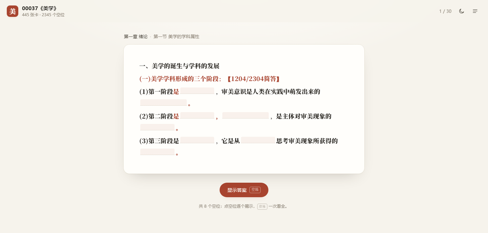

# 00037《美学》全书笔记闪卡

自考 00037《美学》的在线闪卡，内容整理自 Anki 牌组《00037《美学》2604全书笔记》：**445 张卡片、2345 个填空**，覆盖全书六章。

纯静态站点：无框架、无构建、无依赖、无网络请求。双击 `index.html` 即可离线使用，也可以直接部署到 GitHub Pages。

<p align="center">
  
</p>

## 功能

- **填空式回忆**：卡片正文保留原来的挖空，空位统一成柔和的虚线块，宽度只做粗细区分，不提示具体字数。
- **逐条揭示**：点某个空位只揭示那一个，按 `空格` 一次看全；揭示后可以自评「忘记 / 模糊 / 记住」。
- **间隔复习**：评「忘记」当轮稍后再考；「模糊 / 记住」把间隔逐次拉长（1 → 2 → 5 → 12 → 28 … 天），到期才回到「今日复习」。
- **目录导航**：六章 25 节，按章 / 节直接开练，右边数字显示「已掌握 / 总数」。
- **全文搜索**：章节名、考点标注、正文和**答案**都能搜到，点搜索结果从那一张开始连刷。
- **进度留存**：进度只写在浏览器 `localStorage`（键名 `meixue-00037-v1`），换设备不同步，清缓存会丢。
- **简洁界面**：纸张底色 + 宋体正文 + 朱红强调，深色模式、手机适配、键盘操作齐全。

## 目录结构

```
aesthetics-flashcards/
├── index.html            # 页面结构
├── assets/
│   ├── style.css         # 样式（含深色模式）
│   ├── app.js            # 交互：揭示、评分、队列、目录、搜索
│   └── icon.svg          # favicon
├── data/
│   ├── cards.js          # 卡片数据（页面实际加载这个）
│   └── cards.json        # 同一份数据的 JSON 版
├── scripts/
│   └── build_cards.py    # 从 .apkg 重新生成上面的数据
└── README.md
```

页面与数据分离：换牌组只要重新跑一遍 `scripts/build_cards.py`，不用改 HTML/JS。

## 数据格式

`data/cards.js` 的内容是 `window.MEIXUE_DATA = { meta, cards }`，用普通 `<script>` 加载，所以在 `file://` 下也不会遇到跨域问题。

```js
{
  "id": 1766233467307,       // 原 Anki note id，进度以它为准
  "c": 0,                    // 章序号，对应 meta.chapters
  "ch": "第一章 绪论",
  "sec": "第一节 美学的学科属性",
  "body": "<div>……<span class=\"blk m\" data-a=\"0\"></span>……</div>",
  "a": ["审美意识", "不明晰的审美追求"],   // 按 data-a 索引的答案，可含 <span class="hl">
  "t": "……",                // 正文纯文本，用于搜索/摘要
  "p": "……",                // 前 64 字，用于列表摘要
  "n": 8                     // 这张卡的空位数
}
```

## 重新生成数据

```bash
python scripts/build_cards.py "00037《美学》2604全书笔记（完整版）.apkg"
```

脚本做的事：

1. 解开 `.apkg`，读 `collection.anki21` / `collection.anki2`（SQLite），按 `notes` 表逐条取内容。
2. **删掉原模板里的推广标注**（牌组作者塞在卡片模板里的公众号导流那一行），成品页里不再出现。
3. 把 `{{c1::答案}}` 换成空位，答案单独存进 `a` 数组。
4. 清洗 HTML：丢掉颜色、字号等内联样式，只留加粗、下划线、换行等结构；原来的红笔标注收敛成 `.hl` 强调色。
5. 从每张卡开头的 `h2` 和「第X节」里抽出章 / 节，作为面包屑和目录分组，并从正文里去掉重复标题。

需要 Python 3 和 `lxml`。如果牌组是 zstd 压缩的新版格式，请先在 Anki 里用「导出 → 支持旧版 Anki 的 .apkg」再导一次。

## 本地预览

直接双击 `index.html` 就能用。想在手机上试，起个静态服务器：

```bash
python -m http.server 8000
# 打开 http://localhost:8000/
```

## 部署到 GitHub Pages

**单独建一个仓库**：把本目录**里面的内容**（`index.html`、`assets/`、`data/`、`.nojekyll`）上传到仓库根目录，然后在 Settings → Pages 选择 `main` 分支 `/ (root)`，访问：

```
https://<用户名>.github.io/<仓库名>/
```

**放进已有仓库**：把整个文件夹传上去，访问 `https://<用户名>.github.io/<仓库名>/aesthetics-flashcards/`。

> 网页上传时务必把 `assets/` 和 `data/` 两个文件夹一起传，否则样式、脚本或卡片数据会 404。

## 快捷键

| 按键 | 作用 |
| --- | --- |
| `空格` / `回车` | 揭示全部空位；已揭示时 = 记住 |
| `1` | 忘记（当轮稍后再出现） |
| `2` | 模糊 |
| `3` | 记住 |
| `Esc` | 关闭目录 |
| `/` | 打开目录并聚焦搜索 |

手机上直接点空位揭示、点按钮评分。

## 说明

- 卡片文字全部来自原牌组，只做了去推广、去样式和结构整理，没有增删知识点。
- 原卡里的考点标注（如 `【1204/2304简答】`）保留，作为复习优先级的参考。
- 进度数据不上传任何服务器。
